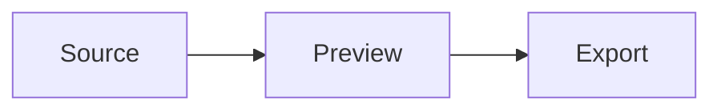

# Mermaid Preview

Preview [Mermaid](https://mermaid.js.org/) diagrams beside their Markdown source,
with diagram navigation, pan, zoom, fit, and SVG export.

Rendering happens locally. Mermaid ships inside the extension, so previews work
offline and no document ever leaves the machine.

## Features

- Detects every fenced `mermaid` block in a document, including CRLF files.
- Navigates between diagrams with toolbar actions or the arrow keys.
- Pans by dragging, zooms with the mouse, and fits the diagram with `F`.
- Exports the current diagram as SVG.
- Follows the active VS Code light or dark theme.

## Getting Started

Open a Markdown file containing a Mermaid fence and run **Mermaid: Open
Preview** from the Command Palette, the editor title bar, the Explorer context
menu, or `Ctrl+Shift+M`.

````markdown

````

## Commands

| Command | Shortcut | Availability |
| --- | --- | --- |
| `Mermaid: Open Preview` | `Ctrl+Shift+M` | Markdown editors and `.md` files |

The extension contributes no settings.

## Privacy

Diagram extraction and rendering are local. The extension performs no network
requests, collects no telemetry, and loads Mermaid from the bundled copy rather
than a CDN.

## Limitations

- Only fenced code blocks tagged `mermaid` are rendered.
- SVG export reflects the output of the bundled Mermaid renderer.

## Installation

Download the `.vsix` from the Releases page and install it:

```bash
code --install-extension vscode-mermaid-preview-<version>.vsix
```

## Third-Party

[Mermaid](https://github.com/mermaid-js/mermaid) ships inside the extension
under the MIT license. Its copyright notice travels in the bundled file.

## License

[MIT](LICENSE) © [Antonio Abreu Filho](https://abreufilho.com.br)
