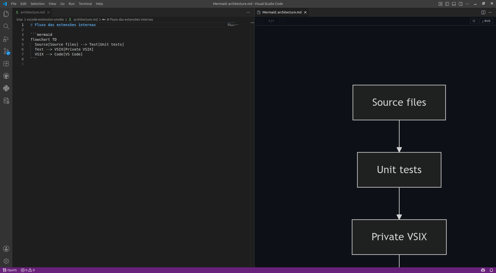
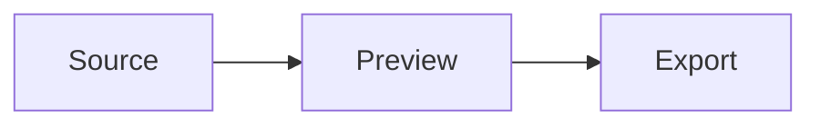

# Mermaid Preview

[](https://github.com/abreufilho/vscode-mermaid-preview/actions/workflows/ci.yml)
[](https://github.com/abreufilho/vscode-mermaid-preview/releases/latest)
[](LICENSE)

Preview [Mermaid](https://mermaid.js.org/) diagrams beside their Markdown source,
with diagram navigation, pan, zoom, fit, and SVG export.

Rendering happens locally. Mermaid ships inside the extension, so previews work
offline and no document ever leaves the machine.



## Requirements

VS Code 1.125 or later. The extension has no other dependency.

## Installation

Download the `.vsix` from the [latest release](https://github.com/abreufilho/vscode-mermaid-preview/releases/latest)
and install it:

```bash
code --install-extension mermaid-preview-<version>.vsix
```

## Usage

Open a Markdown file containing a Mermaid fence and run **Mermaid: Open
Preview** from the Command Palette, the editor title bar, the Explorer context
menu, or `Ctrl+Shift+M`.

````markdown

````

Move between diagrams with the arrow keys, drag to pan, scroll to zoom, and
press `F` to fit the diagram to the panel. The preview refreshes when the
document is saved.

## Features

- Detects every fenced `mermaid` block in a document, including CRLF files.
- Navigates between diagrams with toolbar actions or the arrow keys.
- Pans by dragging, zooms with the mouse, and fits the diagram with `F`.
- Exports the current diagram as SVG.
- Follows the active VS Code light or dark theme.

## Commands

| Command | Shortcut | Availability |
| --- | --- | --- |
| `Mermaid: Open Preview` | `Ctrl+Shift+M` | Markdown editors and `.md` files |

The extension contributes no settings.

## Privacy

Diagram extraction and rendering are local. The extension performs no network
requests, collects no telemetry, and loads Mermaid from the bundled copy rather
than a CDN.

## Limitations

- Only fenced code blocks tagged `mermaid` are rendered.
- SVG export reflects the output of the bundled Mermaid renderer.

## Contributing

Read [CONTRIBUTING.md](CONTRIBUTING.md) for the local setup and the checks that
run before a pull request. Participation follows the
[Code of Conduct](CODE_OF_CONDUCT.md). To report a vulnerability, see the
[security policy](SECURITY.md).

## Third-Party

[Mermaid](https://github.com/mermaid-js/mermaid) ships inside the extension
under the MIT license. Its copyright notice travels in the bundled file.

## License

[MIT](LICENSE) © [Antonio Abreu Filho](https://abreufilho.com.br)
